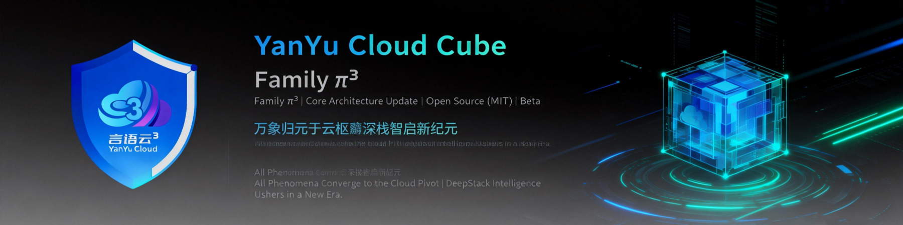
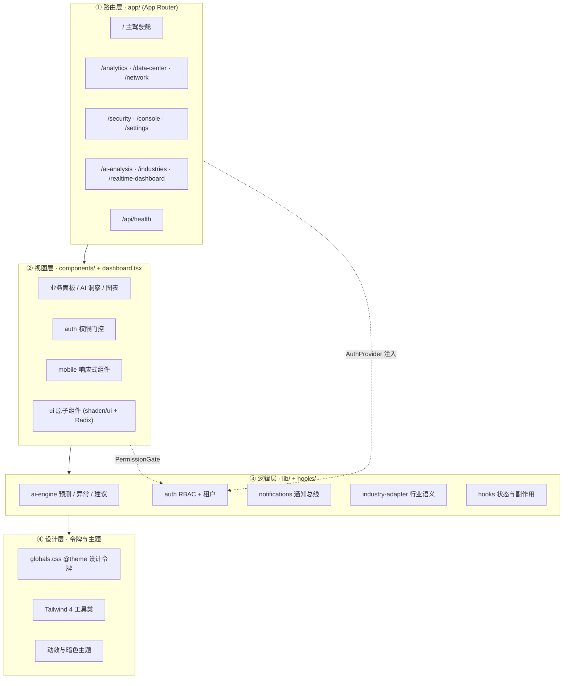
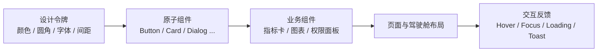
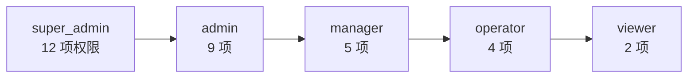

<p align="center">
  
</p>

<h1 align="center">星云操作系统 · NebulaOS</h1>

<p align="center">
  <strong>企业级 AI 智能管理平台</strong><br/>
  <em>YYC³（YanYuCloudCube™ · 注册商标）</em><br/>
  言启象限 | 语枢未来<br/>
  <i>Words Initiate Quadrants, Language Serves as Core for Future</i><br/>
  万象归元于云枢 | 深栈智启新纪元<br/>
  <i>All things converge in cloud pivot; Deep stacks ignite a new era of intelligence</i>
</p>

<p align="center">
  <a href="https://github.com/YYC-Cube/YYC3-Nebula-OS"></a>
  <a href="https://nextjs.org"></a>
  <a href="https://react.dev"></a>
  <a href="https://www.typescriptlang.org"></a>
  <a href="https://tailwindcss.com"></a>
  <a href="https://ui.shadcn.com"></a>
  <a href="https://www.radix-ui.com"></a>
  <a href="https://pnpm.io"></a>
  <a href="https://nodejs.org">=20.9" /></a>
  <a href="LICENSE"></a>
  <a href=".github/workflows/ci.yml"></a>
  <a href="CONTRIBUTING.md"></a>
  <a href="#"></a>
</p>

---

## 一、项目简介

**星云操作系统（NebulaOS）** 是面向企业级场景的 AI 智能管理平台（Intelligent Cockpit），以「五高架构 · 五标体系 · 五化转型 · 五维评估」为设计骨架，将实时监控、预测分析、异常检测、权限治理与数据可视化收敛到统一驾驶舱。

| 命名层级 | 取值 |
| ---- | ---- |
| 中文名 | 星云操作系统 |
| 英文名 | **NebulaOS** |
| 英文全称 | YYC³ Nebula Operating System |
| 代码标识 | `yyc3-nebula-os` |
| 仓库 | [YYC-Cube/YYC3-Nebula-OS](https://github.com/YYC-Cube/YYC3-Nebula-OS) |

- **零后端依赖即可演示**：内置模拟数据与 AI 推理引擎，`pnpm dev` 即可完整体验。
- **可渐进接入真实系统**：数据源、AI 引擎、权限中心均以模块化边界隔离，替换实现即可对接生产。
- **开源级工程基座**：Next.js 16 App Router + React 19 + TypeScript + Tailwind CSS 4 + shadcn/ui，配套 CI 质量门禁与规范文档。

---

## 二、核心能力

| 能力域 | 说明 | 关键实现 |
| ---- | ---- | ---- |
| AI 智能分析 | 移动平均预测、Z-score 异常检测、线性回归趋势、智能建议 | [`lib/ai-engine.ts`](./lib/ai-engine.ts)、[`lib/enhanced-ai-engine.ts`](./lib/enhanced-ai-engine.ts) |
| 多租户 RBAC | 5 级角色 × 12 项细粒度权限，租户隔离与 UI 门控 | [`lib/auth`](./lib/auth)、[`components/auth`](./components/auth) |
| 高级可视化 | 折线 / 热力 / 径向 / 区域 / 实时仪表盘 5 类图表 | [`components/charts`](./components/charts) |
| 实时协作 | 通知中心、活动流、团队在线状态 | [`components/notifications`](./components/notifications)、[`components/collaboration`](./components/collaboration) |
| 全端响应式 | 桌面驾驶舱 + 移动端底部导航与专用卡片 | [`components/mobile`](./components/mobile)、[`hooks/use-mobile.tsx`](./hooks/use-mobile.tsx) |
| 行业适配 | 行业模板与指标语义适配层 | [`lib/industry-adapter.ts`](./lib/industry-adapter.ts)、[`app/industries`](./app/industries) |
| 设计系统 | 54 个 shadcn/ui 原子组件 + Radix 无障碍原语 + 设计令牌 | [`components/ui`](./components/ui)、[`app/globals.css`](./app/globals.css) |

---

## 三、技术栈

| 层级 | 技术 | 版本 | 说明 |
| ---- | ---- | ---- | ---- |
| 框架 | Next.js | 16.4.5 | App Router、Turbopack 默认、RSC |
| 运行时 | React / React DOM | 19.3 | 并发渲染、Actions |
| 语言 | TypeScript | 5.9 | 路径别名 `@/*` |
| 样式 | Tailwind CSS | 4.3 | CSS-first `@theme`、`@tailwindcss/postcss` |
| 组件 | shadcn/ui + Radix UI | 最新 | 无障碍、可组合、可定制 |
| 动效 | tw-animate-css / CSS Keyframes | 1.4 | 入场、循环、状态过渡 |
| 图表 | Recharts | 2.15 | 组合式 SVG 图表 |
| 表单 | React Hook Form + Zod | 7.x / 3.x | 受控校验 |
| 主题 | next-themes | 0.4 | class 策略暗色模式 |
| 包管理 | pnpm | 12.x | 严格依赖与锁文件 |
| 质量 | ESLint 9 + TypeScript + CI | 9.39 / 5.9 | Flat Config |

---

## 四、项目标签 / GitHub Topics

仓库已配置以下标签，与 `package.json` 的 `keywords` 保持一致：

```text
yyc3  nebula-os  nextjs  react  typescript  tailwindcss  shadcn-ui  radix-ui
ai  dashboard  rbac  data-visualization  enterprise  pwa  intelligent-cockpit
```

关键词（`package.json`）：`yyc3`、`nebula-os`、`nextjs`、`react`、`typescript`、`tailwindcss`、`shadcn-ui`、`radix-ui`、`ai`、`dashboard`、`rbac`、`data-visualization`、`enterprise`、`pwa`、`intelligent-cockpit`。

---

## 五、架构总览



**数据流**：页面 → 业务组件 → Hook → 引擎模块（`lib/*`）→ 模拟数据源。接入真实服务时，仅需替换引擎内部的数据获取实现，UI 与权限层无需改动。

---

## 六、可视化交互体系设计

体系遵循「**令牌 → 组件 → 页面 → 反馈**」四层递进，保证视觉一致性与交互可预测性。



| 设计维度 | 规范 |
| ---- | ---- |
| 色彩 | HSL 语义变量（`--background` / `--primary` / `--destructive`…），亮暗双主题，禁止硬编码色值 |
| 圆角 | `--radius` 派生 `rounded-sm/md/lg`，保持卡片、输入、弹层一致 |
| 字体 | `next/font` 自托管 Inter + JetBrains Mono，`display: swap` 防布局抖动 |
| 动效 | 三档：微交互（150–200ms）、状态过渡（200–300ms）、氛围动画（3–6s 循环） |
| 图表 | 统一轴标注、图例、渐变填充与实时刷新节奏，随容器自适应 |
| 响应式 | 移动优先；≥768px 桌面布局，<768px 切换移动导航与指标网格 |
| 无障碍 | Radix 原语提供键盘导航与焦点管理；语义化标签 + 可见焦点环 + `prefers-reduced-motion` 友好 |

---

## 七、权限模型（RBAC）



| 角色 | 权限范围 |
| ---- | ---- |
| `super_admin` | 全部 12 项权限，含用户 / 角色 / 系统设置 / 资源 / 命令 / 导出 |
| `admin` | 查看仪表板 / 分析 / 数据 / 网络 / 安全 + 用户 / 角色 / 设置 / 导出 |
| `manager` | 查看仪表板 / 数据 / 网络 / 安全 + 资源管理 |
| `operator` | 查看仪表板 / 数据 / 网络 + 执行命令 |
| `viewer` | 查看仪表板 / 数据中心 |

权限点：`view:dashboard`、`view:analytics`、`view:data`、`view:network`、`view:security`、`view:insights`、`manage:users`、`manage:roles`、`manage:settings`、`manage:resources`、`execute:commands`、`export:data`。

```tsx
import { useAuth } from "@/lib/auth/auth-context"
import { PermissionGate } from "@/components/auth/permission-gate"

const { hasPermission } = useAuth()

{hasPermission("manage:users") && <UserManagementPanel />}

<PermissionGate permission="view:analytics">
  <AnalyticsContent />
</PermissionGate>
```

---

## 八、快速开始

### 环境要求

- Node.js **≥ 20.9**（推荐 22 LTS）
- pnpm **≥ 9**（推荐 12）

### 安装与启动

```bash
# 1. 安装依赖
pnpm install

# 2. 启动开发服务器（默认端口 3169）
pnpm dev

# 3. 访问
open http://localhost:3169
```

### 生产构建

```bash
pnpm build   # Next.js 16 生产构建
pnpm start   # 以生产模式启动
```

### 常用脚本

| 脚本 | 命令 | 作用 |
| ---- | ---- | ---- |
| `dev` | `next dev -p 3169` | 开发服务器（Turbopack） |
| `build` | `next build` | 生产构建 |
| `start` | `next start` | 生产运行 |
| `lint` | `eslint .` | ESLint 9 Flat Config 检查 |
| `typecheck` | `tsc --noEmit` | TypeScript 类型检查 |
| `validate:permissions` | `tsx scripts/validate-permissions.ts` | 校验角色权限映射合法性 |
| `verify` | `pnpm lint && pnpm typecheck && pnpm validate:permissions && pnpm build` | 本地 / CI 全量门禁 |

---

## 九、目录结构

```text
├── app/                      # App Router 路由与全局样式
│   ├── layout.tsx            # 根布局（字体 + AuthProvider）
│   ├── page.tsx              # 主驾驶舱入口
│   ├── globals.css           # Tailwind 4 入口 + 设计令牌
│   ├── api/health/           # 健康检查接口
│   └── {analytics,data-center,network,security,console,
│        communications,settings,ai-analysis,industries,
│        realtime-dashboard}/ # 业务页面
├── components/
│   ├── ui/                   # shadcn/ui 原子组件
│   ├── charts/               # 高级图表
│   ├── auth/                 # 权限上下文 / 门控 / 面板
│   ├── mobile/               # 移动端组件
│   ├── collaboration/        # 协作与在线状态
│   ├── notifications/        # 通知中心
│   └── *.tsx                 # 业务与动效组件
├── lib/                      # AI 引擎 / RBAC / 通知 / 行业适配
├── hooks/                    # AI 分析 / 移动端 / 通知 / Toast
├── docs/                     # 标规文档、开发指南、验收体系
├── scripts/                  # 校验与部署脚本
├── public/                   # 静态资源与品牌图
├── dashboard.tsx             # 主驾驶舱视图
├── eslint.config.mjs         # ESLint 9 Flat Config
└── postcss.config.mjs        # Tailwind 4 PostCSS 插件
```

---

## 十、页面路由

| 路由 | 页面 | 权限要求 |
| ---- | ---- | ---- |
| `/` | 主驾驶舱 | `view:dashboard` |
| `/analytics` | 数据分析 | `view:analytics` |
| `/data-center` | 数据中心 | `view:data` |
| `/network` | 网络监控 | `view:network` |
| `/security` | 安全防护 | `view:security` |
| `/console` | 系统控制台 | `execute:commands` |
| `/communications` | 通讯中心 | 无 |
| `/settings` | 系统设置 | `manage:settings` |
| `/ai-analysis` | AI 智能分析 | `view:insights` |
| `/industries` | 行业解决方案 | 无 |
| `/realtime-dashboard` | 实时数据大屏 | `view:dashboard` |
| `/api/health` | 健康检查 | 无 |

---

## 十一、文档体系

| 文档 | 说明 |
| ---- | ---- |
| [文档总索引](./docs/README.md) | 全局文档架构导航（标规 / 指南 / 验收） |
| [架构设计](./ARCHITECTURE.md) | 分层架构、模块边界与扩展点 |
| [API 参考](./API.md) | 接口约定与数据契约 |
| [部署指南](./DEPLOYMENT.md) | Vercel / Docker / 脚本部署 |
| [贡献指南](./CONTRIBUTING.md) | 分支、提交、评审与质量门禁 |
| [行为准则](./CODE_OF_CONDUCT.md) | 社区协作底线 |
| [安全政策](./SECURITY.md) | 漏洞上报与响应流程 |
| [变更记录](./CHANGELOG.md) | 版本演进记录 |
| [团队标规文档](./docs/YYC3-团队通用-标规文档/README.md) | 五维驱动 / 开发标准 / 命名 / 标头标尾 / 文档闭环 |
| [开发指南](./docs/YYC3-团队通用-开发指南/README.md) | 快速入门、架构总纲、编码规范等 9 篇 |
| [闭环验收体系](./docs/YYC3-项目闭环-验收系统/README.md) | 测试、审核、上线与安全验收 |

---

## 十二、质量与安全

- **CI 门禁**：GitHub Actions 在 Node 22 + pnpm 12 上执行 `pnpm verify`。
- **依赖治理**：`pnpm` 严格锁文件，`allowBuilds` 白名单放行构建脚本。
- **安全基线**：响应头包含 `X-Content-Type-Options`、`X-Frame-Options`、`Referrer-Policy`；详见 [SECURITY.md](./SECURITY.md)。
- **类型与规范**：TypeScript 5.9 + ESLint 9 Flat Config；存量告警按规则分级治理。

---

## 十三、贡献

欢迎参与共建。提交前请阅读 [CONTRIBUTING.md](./CONTRIBUTING.md) 与 [CODE_OF_CONDUCT.md](./CODE_OF_CONDUCT.md)，并确保：

```bash
pnpm lint
pnpm typecheck
pnpm validate:permissions
pnpm build
```

---

## 十四、许可证

本项目采用 [MIT License](./LICENSE) 开源。
Copyright © 2026 YanYuCloudCube™（YYC³）· YYC³ Team

---

## 变更历史

| 版本 | 日期 | 变更内容 | 作者 |
| ---- | ---- | -------- | ---- |
| v2.0.0 | 2026-11-07 | 升级 Next.js 16.4 / React 19.3 / Tailwind CSS 4.3 / ESLint 9 / TypeScript 5.9；重建标规文档体系与徽章、可视化架构说明 | YYC³ Team |
| v1.0.0 | 2025-01-25 | 初始版本：AI 引擎、RBAC、图表、通知与响应式 | YYC³ Team |

---

<p align="center">
  <b>YYC³</b>（YanYuCloudCube™ · 注册商标）<br>
  言启象限 | 语枢未来<br>
  <i>Words Initiate Quadrants, Language Serves as Core for Future</i><br>
  万象归元于云枢 | 深栈智启新纪元<br>
  <i>All things converge in cloud pivot; Deep stacks ignite a new era of intelligence</i><br>
  <sub>© 2026 YanYuCloudCube™（YYC³）· <a href="mailto:admin@0379.email">admin@0379.email</a></sub>
</p>
