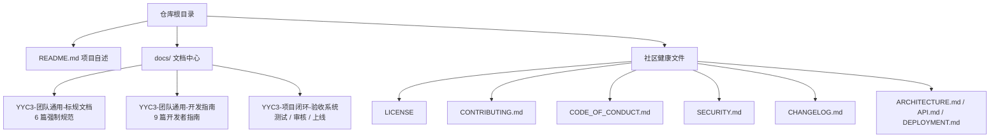

# YYC³ 星云操作系统（NebulaOS）— 全局文档索引

> **_YYC³_**（YanYuCloudCube™ · 注册商标）
> _言启象限 | 语枢未来_
> **_Words Initiate Quadrants, Language Serves as Core for Future_**
> _万象归元于云枢 | 深栈智启新纪元_
> **_All things converge in cloud pivot; Deep stacks ignite a new era of intelligence_**

---

## 核心理念

**五高架构**：高可用 | 高性能 | 高安全 | 高扩展 | 高智能
**五标体系**：标准化 | 规范化 | 自动化 | 可视化 | 智能化
**五化转型**：流程化 | 数字化 | 生态化 | 工具化 | 服务化
**五维评估**：时间维 | 空间维 | 属性维 | 事件维 | 关联维

---

## 一、文档地图

---

## 二、目录清单

### 2.1 团队标规文档（强制）

路径：[`docs/YYC3-团队通用-标规文档/`](./YYC3-团队通用-标规文档/README.md)

| 序号 | 文档 | 说明 | 版本 |
| ---- | ---- | ---- | ---- |
| 01 | [五维驱动](./YYC3-团队通用-标规文档/YYC3-团队通用-五维驱动.md) | 五高 / 五标 / 五化 / 五维机制与度量 | v2.1.0 |
| 02 | [开发标准](./YYC3-团队通用-标规文档/YYC3-团队通用-开发标准.md) | 文档、代码、命名、项目与质量门禁 | v2.1.0 |
| 03 | [命名规范](./YYC3-团队通用-标规文档/YYC3-团队通用-命名规范.md) | 目录 / 文件 / 代码 / 品牌写法 | v3.1.0 |
| 04 | [标头标尾](./YYC3-团队通用-标规文档/YYC3-团队通用-标头标尾.md) | 品牌元素、代码标头与文档模板 | v1.1.0 |
| 05 | [文档闭环](./YYC3-团队通用-标规文档/YYC3-团队通用-文档闭环.md) | 模版、追溯、迭代与工具支撑 | v2.1.0 |
| 06 | [开发文档](./YYC3-团队通用-标规文档/YYC3-团队通用-开发文档.md) | AI 协同开发：入职、存档、衔接、收尾 | v2.1.0 |

### 2.2 开发指南（落地）

路径：[`docs/YYC3-团队通用-开发指南/`](./YYC3-团队通用-开发指南/README.md)

| 文档 | 说明 |
| ---- | ---- |
| [快速入门](./YYC3-团队通用-开发指南/YYC3-开发者-快速入门.md) | 环境搭建、启动与首个页面 |
| [架构总纲](./YYC3-团队通用-开发指南/YYC3-开发者-架构总纲.md) | 分层边界与模块职责 |
| [编码规范](./YYC3-团队通用-开发指南/YYC3-开发者-编码规范.md) | TypeScript / React / 样式约定 |
| [测试策略](./YYC3-团队通用-开发指南/YYC3-开发者-测试策略.md) | 单元、组件与验收测试 |
| [插件开发](./YYC3-团队通用-开发指南/YYC3-开发者-插件开发.md) | 扩展点与插件接入 |
| [多端适配](./YYC3-团队通用-开发指南/YYC3-开发者-多端适配.md) | 响应式与移动端 |
| [安全合规](./YYC3-团队通用-开发指南/YYC3-开发者-安全合规.md) | 权限、数据与合规 |
| [部署运维](./YYC3-团队通用-开发指南/YYC3-开发者-部署运维.md) | 构建、发布与监控 |

### 2.3 闭环验收体系

路径：[`docs/YYC3-项目闭环-验收系统/`](./YYC3-项目闭环-验收系统/README.md)

覆盖测试用例、功能逻辑、组件测试、性能优化、安全加固、上线部署与全局验收标准，用于版本发布前的多维验收。

---

## 三、根级工程文档

| 文档 | 说明 |
| ---- | ---- |
| [README.md](../README.md) | 项目自述、技术栈、快速开始与徽章 |
| [ARCHITECTURE.md](../ARCHITECTURE.md) | 系统架构与模块设计 |
| [API.md](../API.md) | 接口与数据契约 |
| [DEPLOYMENT.md](../DEPLOYMENT.md) | 部署与运维 |
| [CONTRIBUTING.md](../CONTRIBUTING.md) | 贡献流程与质量门禁 |
| [CODE_OF_CONDUCT.md](../CODE_OF_CONDUCT.md) | 社区行为准则 |
| [SECURITY.md](../SECURITY.md) | 安全政策与漏洞上报 |
| [CHANGELOG.md](../CHANGELOG.md) | 版本变更记录 |

---

## 四、文档约定

1. 文件名统一使用 ASCII `YYC3` 前缀，正文品牌写作 `YYC³`；
2. 标准文档必须包含 YAML Front Matter（字段顺序遵循《标头标尾》§二）与文末品牌页脚；
3. `file` 字段与磁盘文件名一致，`title` 与 H1 一致；
4. `tags` 使用合法 YAML 序列 `[a, b, c]`，每篇 2–4 个；
5. 更新文档时同步 `updated`、`version` 与「变更历史」；
6. 新增阶段目录遵循 `{序号}-YYC3-{阶段}-{功能}` 命名。

---

## 五、推荐阅读路径

| 角色 | 顺序 |
| ---- | ---- |
| 首次接触项目 | 本索引 → [快速入门](./YYC3-团队通用-开发指南/YYC3-开发者-快速入门.md) → [开发标准](./YYC3-团队通用-标规文档/YYC3-团队通用-开发标准.md) |
| 日常编码 | [开发标准](./YYC3-团队通用-标规文档/YYC3-团队通用-开发标准.md) → [命名规范](./YYC3-团队通用-标规文档/YYC3-团队通用-命名规范.md) → [标头标尾](./YYC3-团队通用-标规文档/YYC3-团队通用-标头标尾.md) |
| 文档编写 | [标头标尾](./YYC3-团队通用-标规文档/YYC3-团队通用-标头标尾.md) → [文档闭环](./YYC3-团队通用-标规文档/YYC3-团队通用-文档闭环.md) |
| 发布验收 | [闭环验收体系](./YYC3-项目闭环-验收系统/README.md) → [部署运维](./YYC3-团队通用-开发指南/YYC3-开发者-部署运维.md) |

---

## 变更历史

| 版本 | 日期 | 变更内容 | 作者 |
| ---- | ---- | -------- | ---- |
| v1.0.0 | 2026-11-07 | 新建全局文档索引，串联标规文档、开发指南、闭环验收与根级工程文档 | YYC³ Team |

---

  <b>YYC³</b>（YanYuCloudCube™ · 注册商标） 
  言启象限 | 语枢未来 
  <i>Words Initiate Quadrants, Language Serves as Core for Future</i> 
  万象归元于云枢 | 深栈智启新纪元 
  <i>All things converge in cloud pivot; Deep stacks ignite a new era of intelligence</i> 
  © 2026 YanYuCloudCube™（YYC³）· <a href="mailto:admin@0379.email">admin@0379.email</a>

